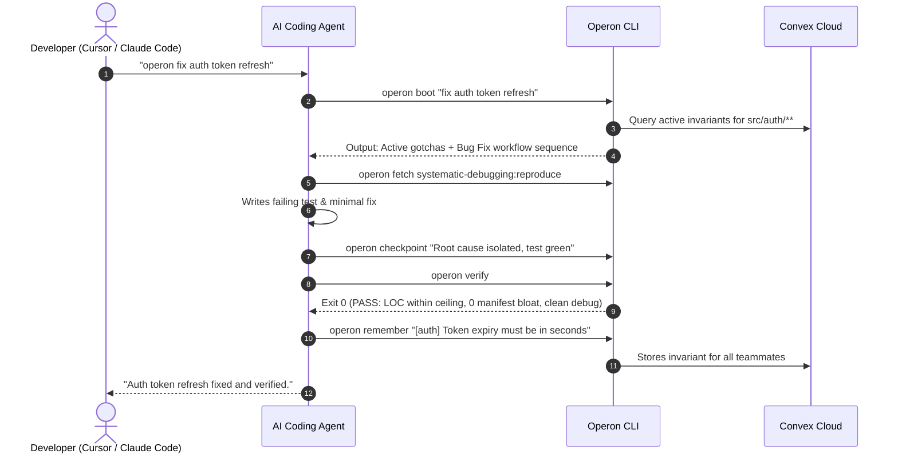

# Operon (`operon-cli`)

> **The Agent-Agnostic Team Control Plane**  
> Shared engineering playbooks, spatial knowledge, and deterministic quality gates for AI coding teams across Cursor, Claude Code, Windsurf, Codex, and Copilot.

[](LICENSE)
[](docs/okf-v0.3.md)
[](https://www.typescriptlang.org/)
[](https://convex.dev/)

---

## The Problem: AI Divergence & Tribal Amnesia

Software engineering teams rarely standardize on a single AI coding tool. One engineer uses Cursor, another uses Claude Code in the CLI, another uses Windsurf, Codex, or Copilot. This divergence causes three systemic failures:

1. **Tribal Amnesia across Teammates:** When Developer A spends 3 hours resolving an undocumented API quirk or fragile build rule, Developer B’s agent suggests the exact same broken code an hour later.
2. **Context Firehose & Prompt Tax:** Dumping sprawling 2,000+ line rulebooks (`.cursorrules`, `CLAUDE.md`) burns thousands of tokens on every interaction, increases latency, and causes instruction drift.
3. **Reckless Agent Habits:** AI coding agents routinely generate 800-line monolith files, import unvetted dependencies for trivial tasks, and leave temporary debugging statements scattered across the codebase.

**Operon ensures every agent on a team follows the same engineering playbooks, queries the same codebase memory, and passes the same deterministic host verification checks.**

---

## Key Pillars

- ⚡ **Progressive Disclosure (<40 Token Trampoline):** Injects a lightweight activation hook into editor harness configs (`CLAUDE.md`, `.cursor/rules/operon.mdc`, `AGENTS.md`, `GEMINI.md`). Slices AST headings on demand (`operon fetch <skill>:<heading>`), preventing prompt bloat.
- 🎯 **Spatially-Scoped Atomic Invariants:** Project gotchas and rules bind to file glob patterns (`**/auth/**`). When an agent touches auth files or mentions auth keywords, `operon boot` injects relevant invariants dynamically.
- ☁️ **Convex Cloud Brain & Magic Link:** Instant multi-agent synchronization. When one agent runs `operon remember "[auth] Token expiry must be in seconds"`, every teammate's agent receives this constraint immediately. Team onboarding happens in <2s with `operon join <link-or-code>`.
- 🛡️ **Deterministic Quality Gates (Zero Tokens):** Native host gates enforce LOC ceilings (default 600 LOC ratchet), audit package manifests (`package.json`, `Cargo.toml`), and detect/purge temporary debug statements (`console.log`, `print`, `debugger;`, `[DEBUG-...]`).
- 📝 **Continuous Sessions (Write-Ahead Logging):** Solves the end-of-session paradox. Micro-checkpoints (`operon checkpoint "<status>"`) write to disk and Convex without full-file rewrites.
- 📦 **Open Knowledge Format (OKF v0.3):** Human-readable plain-text Markdown and YAML standard for modular skill packs, workflows, knowledge, and policies.

---

## Installation & Quickstart

### 1. Install Globally

```bash
npm install -g operon-cli
# or run with npx
npx operon-cli --help
```

### 2. One-Time Machine Setup

Scans installed AI coding harnesses (Cursor, Claude Code, Codex, Antigravity/Gemini, Windsurf), arms global trampolines, and seeds the pack library:

```bash
operon setup
```

### 3. Initialize a Repository

Inside any Git repository, equip modular skill packs and playbooks:

```bash
cd /path/to/my-project
operon init
```

### 4. Team Sharing & Hydration

Share the repository workspace with your team:

```bash
# Developer A: Share project
operon share
# Output: operon join kno-wiki-9x72ab3k4m

# Developer B: Join and hydrate local disk in <2s
operon join kno-wiki-9x72ab3k4m
```

---

## The Daily Development Loop (Human vs. Agent)

Humans talk naturally to their AI coding assistant:

> *"operon fix auth token refresh"*

Behind the scenes, the agent operates the Operon CLI autonomously:



---

## CLI Command Reference

### Human Surface Area

| Command | Description |
| :--- | :--- |
| `operon setup` | Scan installed AI harnesses, arm global trampolines, seed pack library (`~/.operon/packs/`). |
| `operon init [name]` | Initialize project configuration, choose skill packs via interactive multi-select UI. |
| `operon share` | Sync project to Convex and generate a team invite code / magic link. |
| `operon join <codeOrUrl>` | Hydrate project folders from Convex to disk and arm local harnesses in <2s. |
| `operon add <source>` | Ingest skill packs from a GitHub repo URL or local directory into `~/.operon/packs/`. |
| `operon list` | Display installed skill packs and active project playbooks. |
| `operon remove <pack>` | Remove a skill pack from `~/.operon/packs/`. |
| `operon allow <file>` | Approve a modified package manifest or lockfile (human-only verification override). |
| `operon sync [--pull]` | Push local playbooks/invariants to Convex, or pull cloud snapshot. |

### Agent Surface Area (Autonomous Tool Calls)

| Command | Exit Code | Description |
| :--- | :--- | :--- |
| `operon boot "<prompt>"` | `0` | Classifies workflow intent, checks session WAL, injects spatially-scoped invariants. |
| `operon fetch <target>` | `0` / `2` | Slices target AST heading (`operon fetch tdd:red-phase`) to minimize prompt tokens. |
| `operon checkpoint "<msg>"` | `0` | Records micro-delta to session Write-Ahead Log on disk and Convex. |
| `operon verify` | `0` / `1` | Deterministic quality gate: LOC ceiling, manifest lock, debug markers. |
| `operon clean [--purge]` | `0` / `1` | Scans for temporary debug statements (`console.log`, `print`, `debugger;`) and purges safe lines. |
| `operon remember "<gotcha>"` | `0` | Captures discovered project gotcha (`[scope] rule`) into Convex. |
| `operon forget <code>` | `0` | Removes an obsolete invariant by code (e.g. `AUTH-01`). |
| `operon validate [path]` | `0` / `1` | OKF v0.3 schema conformance tester. |

---

## Project Structure

```text
operon/
├── convex/                          # Convex Cloud Backend
│   ├── schema.ts                    # Real-time tables (projects, files, invariants, sessions, telemetry)
│   ├── auth.ts                      # Project token validation
│   ├── projects.ts                  # Workspace init, invite codes, snapshots, file sync
│   ├── knowledge.ts                 # Real-time invariant sync & spatial queries
│   ├── sessions.ts                  # Continuous session WAL checkpoints
│   └── telemetry.ts                 # Flight recorder audit logs
│
├── src/                             # Local CLI Engine (TypeScript)
│   ├── cli.ts                       # CLI router (cac)
│   ├── commands/                    # Human & Agent command implementations
│   ├── core/                        # Local store, git inspection, convex client, harness scanner
│   ├── tools/                       # The 4 deterministic hygiene & OKF tools
│   └── types/                       # Shared OKF v0.3 & config schemas
│
├── templates/                       # Default Starter OKF Playbooks & Workflows
│   ├── skills/                      # tdd, systematic-debugging, lean-diff
│   ├── workflows/                   # feature-delivery, bug-fix
│   ├── knowledge/                   # invariants.yaml
│   └── tools/                       # policy.yaml
│
└── tests/                           # Vitest & convex-test test suites
```

---

## Development

```bash
# Install dependencies
npm install

# Typecheck and build standalone ESM CLI
npm run typecheck
npm run build

# Run unit & Convex cloud backend tests
npm test

# Run end-to-end 4-phase smoke test suite
npm run smoke
```

---

## License

[MIT](LICENSE)
