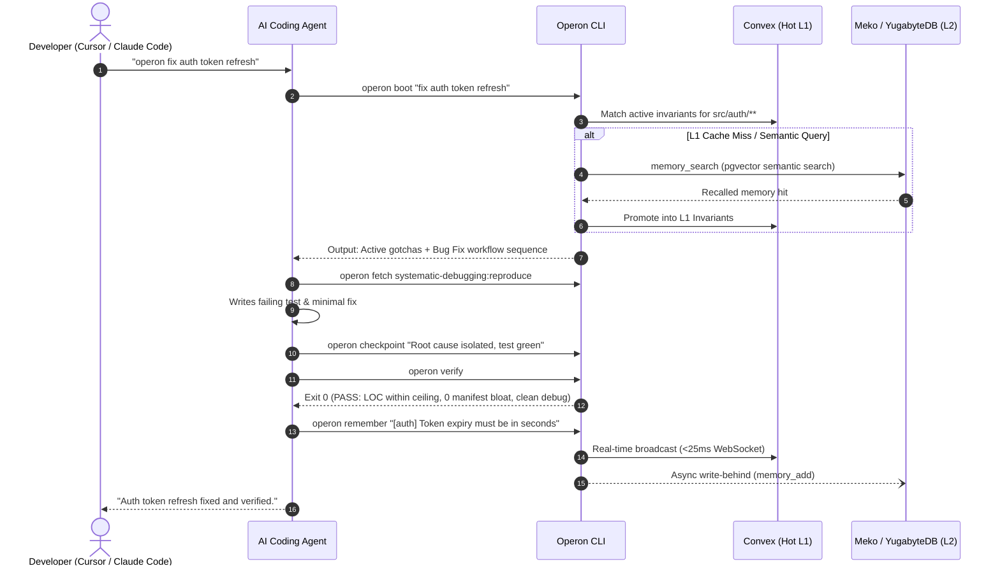

# Operon (`operon-cli`)

> **The Agent-Agnostic Team Control Plane**  
> Shared engineering playbooks, spatial knowledge, and deterministic quality gates for AI coding teams across Cursor, Claude Code, Windsurf, Codex, and Copilot.

[](LICENSE)
[](docs/okf-v0.3.md)
[](https://www.typescriptlang.org/)
[](https://convex.dev/)
[](https://mekodata.ai/)

---

## Why Operon Exists

At 4:45 PM, a teammate prompts an AI coding assistant, clicks "Apply All" without reading the diff, and dumps a 900-line monolith with three redundant dependencies, broken auth, and random debug logs straight into main. Reviewing sloppy AI-generated PRs and untangling tribal merge conflicts should not be your full-time job. 

Operon brings senior engineering discipline to every AI agent on your team. It binds rules to codebase paths, broadcasts active teammate gotchas in real time, and enforces zero-token deterministic quality gates before code ever touches git.

---

## Agent-Native Installation Prompt

If you are using Cursor, Claude Code, Windsurf, Codex, or any agentic terminal, paste this instruction into your agent to install and configure Operon automatically:

```markdown
Install and configure Operon CLI in this project:
1. Clone the repository: git clone https://github.com/abrez-rizvi/operon-cli.git
2. Build and link globally: cd operon-cli && npm install && npm run build && npm link
3. Run machine harness setup: operon setup -y
4. Initialize this repository: operon init --yes
5. Verify setup by running: operon verify (must exit 0)
```

---

## Quickstart

### 1. Install and Link Globally
```bash
# Clone the repository
git clone https://github.com/abrez-rizvi/operon-cli.git
cd operon-cli

# Install dependencies, compile TypeScript, and link CLI globally
npm install
npm run build
npm link
```

### 2. One-Time Machine Setup
Scan installed AI coding harnesses (Cursor, Claude Code, Codex, Windsurf), arm global trampolines (<40 tokens), and seed the local pack library:
```bash
operon setup
```
*(Interactive options allow selecting Pure Local-First, Community Demo Cloud, or custom Convex and Meko / YugabyteDB endpoints).*

### 3. Initialize a Repository
Equip modular skill packs and engineering playbooks inside any git repository:
```bash
cd /path/to/my-project
operon init
```

### 4. Team Sharing and Hydration
Connect teammates over the real-time peer bridge in less than two seconds:
```bash
# Developer A shares the workspace:
operon share
# Output: operon join kno-wiki-9x72ab3k4m

# Developer B connects and hydrates local playbooks:
operon join kno-wiki-9x72ab3k4m
```

---

## Technical Architecture and Key Decisions

Operon was architected specifically for high-velocity teams using heterogeneous AI tools.

```text
               ┌────────────────────────────────────────────────────────┐
               │              AI CODING HARNESS (<40 TOKENS)            │
               │         Cursor · Claude Code · Windsurf · Codex        │
               └───────────────────────────┬────────────────────────────┘
                                           │ operon boot / fetch / remember
                                           ▼
               ┌────────────────────────────────────────────────────────┐
               │                   OPERON CLI ENGINE                    │
               │  • AST Heading Slicer        • Deterministic Host Gates│
               │  • In-Flight Seam Detector   • OKF v0.3 Validator      │
               └───────────────┬────────────────────────▲───────────────┘
                               │                        │
               ┌───────────────▼───────────────┐        │
               │      CONVEX (HOT L1 CACHE)    │        │
               │  • Sub-25ms WebSocket bus     │        │
               │  • In-flight file seams       │        │
               │  • Invariant path matching    │        │
               └───────────────┬───────────────┘        │
             Async Write-Behind│                        │ L1 Cache Miss /
             on `remember`     │                        │ Read-Through on `boot`
                               ▼                        │
               ┌────────────────────────────────────────┴───────────────┐
               │          MEKO / YUGABYTEDB (SEMANTIC L2 STORE)         │
               │  • Durable multi-project memory (FastMCP JSON-RPC 2.0) │
               │  • Hybrid semantic vector RAG (YugabyteDB pgvector)    │
               └────────────────────────────────────────────────────────┘
```

### 1. Bidirectional Cache-Aside Architecture (Convex L1 + Meko/YugabyteDB L2)
- **Convex (Hot Reactive L1):** Functions as a sub-25ms in-memory reactive event bus. Subscribes over WebSockets (`operon watch`) to broadcast active teammate checkpoints and in-flight file seams. Fast local glob lookups provide sub-millisecond path matching.
- **Meko / YugabyteDB (Durable Semantic L2):** Handles long-term enterprise memory across sessions and sibling projects backed by YugabyteDB `pgvector`.
  - **Write-Behind on `remember`:** Invariants write immediately to Convex L1 for instant teammate broadcast, then persist asynchronously to Meko via FastMCP JSON-RPC 2.0 (`memory_add`).
  - **Read-Through on `boot`:** On an L1 cache miss, Operon queries Meko's `memory_search`, retrieves historical gotchas from past sessions or other repositories, and promotes them into Convex L1.
  - **Zero-Risk Fallback:** All remote semantic queries are protected by strict timeouts and degrade cleanly to Convex L1 if Meko hits rate limits or quota boundaries.

### 2. Progressive Disclosure (<40 Tokens) vs. Prompt Bloat
Traditional agent harnesses inject massive 2,000-line rule files that waste thousands of tokens on every prompt and induce instruction drift. Operon injects a tiny trampoline (<40 tokens) that instructs the agent to read `.operon/BOOT.md` for active constraints and slice skill sections on demand via `operon fetch <skill>:<heading>`. Tokens are consumed only for the exact section of the playbook needed for the task.

### 3. In-Flight Seam Collision Detection
When two developers' agents touch overlapping interfaces or files concurrently, `operon watch` detects the conflict over Convex in real time. It injects a warning into `.operon/BOOT.md` while the agent is editing, preventing merge conflicts before code is committed.

### 4. Zero-Token Deterministic Quality Gates (`operon verify`)
Instead of relying on LLM self-evaluation, Operon executes deterministic host gates in native TypeScript:
- **LOC Ceiling Ratchet:** Fails with exit code 1 if any newly created file exceeds the 600 LOC ceiling or if existing files grow beyond the ratchet.
- **Manifest Lock:** Blocks unauthorized additions of new dependencies to `package.json` or `Cargo.toml` without explicit human override (`operon allow`).
- **Debug Artifact Purge:** Detects and flags temporary debug statements (`console.log`, `print`, `debugger;`, `[DEBUG-...]`).

### 5. Two-Division Credential Isolation (Local-First + BYOC)
Operon follows strict privacy separation:
- **Pure Local Mode by Default:** Operon works 100% offline via local git and `.operon/` files. No cloud accounts or credit cards required.
- **Bring-Your-Own-Cloud (BYOC):** Users can run `npx convex dev` to self-host their own backend or supply their own Meko token via `operon setup`. Personal tokens and datapacks are never bundled, committed, or exposed.

---

## The Daily Development Loop (Human vs. Agent)

Developers talk naturally to their AI coding assistant:

> *"operon fix auth token refresh"*

Behind the scenes, the agent operates the Operon CLI autonomously:



---

## CLI Command Reference

### Human Surface Area

| Command | Description |
| :--- | :--- |
| `operon setup` | Scan installed AI harnesses, arm global trampolines, seed pack library (`~/.operon/packs/`). |
| `operon init [name]` | Initialize project configuration, choose skill packs via interactive multi-select UI. |
| `operon share` | Sync project to Convex and generate a team invite code / magic link. |
| `operon join <codeOrUrl>` | Hydrate project folders from Convex to disk and arm local harnesses in <2s. |
| `operon watch` | Real-time WebSocket terminal dashboard: live teammate activity & in-flight seam collision alerts. |
| `operon add <source>` | Ingest skill packs from a GitHub repo URL or local directory into `~/.operon/packs/`. |
| `operon list` | Display installed skill packs and active project playbooks. |
| `operon remove <pack>` | Remove a skill pack from `~/.operon/packs/`. |
| `operon allow <file>` | Approve a modified package manifest or lockfile (human-only verification override). |
| `operon sync [--pull]` | Push local playbooks/invariants to Convex, or pull cloud snapshot. |

### Agent Surface Area (Autonomous Tool Calls)

| Command | Exit Code | Description |
| :--- | :--- | :--- |
| `operon boot "<prompt>" [--semantic]` | `0` | Classifies workflow intent, checks session WAL, injects spatially-scoped invariants from Convex L1 and Meko/YugabyteDB L2. |
| `operon fetch <target>` | `0` / `2` | Slices target AST heading (`operon fetch tdd:red-phase`) to minimize prompt tokens. |
| `operon checkpoint "<msg>"` | `0` | Records micro-delta to session Write-Ahead Log on disk and Convex event bus. |
| `operon verify` | `0` / `1` | Deterministic quality gate: LOC ceiling, manifest lock, debug markers. |
| `operon clean [--purge]` | `0` / `1` | Scans for temporary debug statements (`console.log`, `print`, `debugger;`) and purges safe lines. |
| `operon remember "<gotcha>"` | `0` | Captures discovered project gotcha (`[scope] rule`) into Convex L1 + async write-behind to Meko L2. |
| `operon forget <code>` | `0` | Removes an obsolete invariant by code (e.g. `AUTH-01`). |
| `operon validate [path]` | `0` / `1` | OKF v0.3 schema conformance tester. |

---

## Project Structure

```text
operon/
├── convex/                          # Convex Reactive Cloud Brain (Hot L1 Cache)
│   ├── schema.ts                    # Real-time event bus, entities, invariants, sessions, telemetry
│   ├── events.ts                    # Append-only reactive event feed (checkpoints, seams, gotchas)
│   ├── entities.ts                  # Structured OKF playbooks & skills registry
│   ├── auth.ts                      # Project token validation
│   ├── projects.ts                  # Workspace init, invite codes, snapshots, file sync
│   ├── knowledge.ts                 # Real-time invariant sync & spatial queries
│   ├── sessions.ts                  # Continuous session WAL checkpoints
│   └── telemetry.ts                 # Flight recorder audit logs
│
├── src/                             # Local CLI Engine (TypeScript)
│   ├── cli.ts                       # CLI router (cac)
│   ├── commands/                    # Human & Agent command implementations
│   ├── core/                        # Local store, git, Convex client, Meko L2 client, harness scanner
│   │   ├── meko-client.ts           # FastMCP JSON-RPC 2.0 client for Meko / YugabyteDB
│   │   ├── matching.ts              # Spatial invariant & skill classifier
│   │   └── ...
│   ├── tools/                       # Deterministic hygiene & OKF validation tools
│   └── types/                       # Shared OKF v0.3 & config schemas
│
├── templates/                       # Default Starter OKF Playbooks & Workflows
│   ├── skills/                      # tdd, systematic-debugging, lean-diff, grilling, handoff, ponytail, ui-visual-audit
│   ├── workflows/                   # feature-delivery, bug-fix, codebase-audit
│   ├── knowledge/                   # invariants.yaml
│   └── tools/                       # policy.yaml, token counters, validation scripts
│
└── tests/                           # Vitest & convex-test test suites
```

---

## Development

```bash
# Install dependencies
npm install

# Typecheck and build standalone ESM CLI
npm run typecheck
npm run build

# Run unit & Convex cloud backend tests
npm test

# Run end-to-end 4-phase smoke test suite
npm run smoke
```

---

## License

[MIT](LICENSE)
