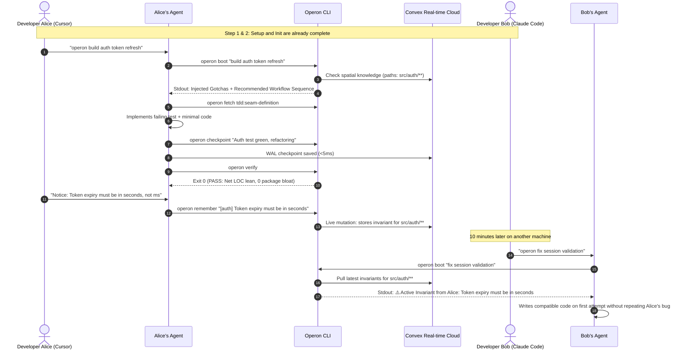

# Operon: The Agent-Agnostic Team Control Plane

Operon is an agent-agnostic CLI control plane and shared repository standard that syncs engineering playbooks, codebase knowledge, and deterministic quality gates across software teams using different AI coding tools.

Operon is built on the **Open Knowledge Format (OKF v0.3)** and powered by a **TypeScript + Convex** stack, giving teams instant, real-time agent alignment without git conflicts, context bloat, or prompt tax.

---

## 1. The Motive

Software teams never standardize on a single AI coding tool. One engineer uses Cursor, another uses Claude Code in the CLI, another uses Windsurf, Codex, or GitHub Copilot. This divergence causes three systemic failures:

1. **Tribal Amnesia across Teammates:** When Developer A spends three hours resolving an undocumented API quirk or fragile build rule, Developer B’s agent suggests the exact same broken code an hour later. Knowledge remains trapped in personal chat histories or Slack threads.
2. **Context Firehose & Prompt Tax:** Teams attempt to fix divergence by dumping sprawling markdown rulebooks into system instructions (`.cursorrules`, `CLAUDE.md`). This burns thousands of tokens on every interaction, increases response latency, and causes instruction drift halfway through long sessions.
3. **Reckless Agent Habits:** AI coding agents routinely generate 800-line monolith files, import unvetted dependencies for trivial tasks, and leave temporary debugging statements scattered across the codebase.

**Operon ensures every agent on a team follows the same engineering playbooks, queries the same codebase memory, and passes the same deterministic host verification checks.**

---

## 2. Architectural Pillars

Operon decouples agent configuration from proprietary tool settings into three foundational concepts:

```text
Team Member A (Cursor) ──┐
Team Member B (Claude)  ──┼──► [ Local CLI / Cache ] ◄──► [ Real-time Convex Sync ]
Team Member C (Codex)   ──┘           │
                                      ▼
                      [ OKF v0.3 Engine & Hygiene Tools ]
```

### Flexible, Decoupled Storage
* **Local Profile by Default:** Project-specific state and ephemeral session checkpoints reside in `~/.operon/projects/<project-hash>/`. The user's product git repository remains 100% untouched.
* **Instant Cloud Sync (Convex):** Knowledge entries, team playbooks, and session state sync in real-time across team members via Convex. When one agent logs a gotcha, every teammate’s agent has immediate access without waiting for a git commit or PR.
* **Independent Version Control (Optional):** Teams can back their playbooks and knowledge with a dedicated Git repository or place an optional `.operon/` directory in-tree if they prefer.

---

## 3. Core Components

Operon standardizes capability into five OKF v0.3 concepts, four deterministic tools, and a thin connector layer:

```text
operon/
├── skills/       # Concept 1: Procedural playbooks (How the team builds and tests)
├── knowledge/    # Concept 2: Codebase memory (Consolidated specs & atomic invariants)
├── tools/        # Concept 3: Deterministic host tools (Mechanical verification gates)
├── workflows/    # Concept 4: Interleaved execution pipelines (Skills + Tools)
├── sessions/     # Concept 5: Continuous sessions (Write-Ahead Log checkpoints)
└── connectors/   # Concept 6: Harness trampolines (<40 token activation hooks)
```

### Concept 1: Skills (`type: Skill`)
* **What it is:** Structured procedural playbooks defining how an agent performs engineering tasks (e.g., test-driven development, lean diffs, root-cause debugging).
* **AST Heading Slicing:** Agents fetch targeted sub-sections (`operon fetch <skill>:<heading>`) rather than reading entire documents, keeping prompt overhead minimal.

### Concept 2: Knowledge (`type: Knowledge`)
Operon bifurcates repository memory into two epistemic forms:
1. **Consolidated Text (Narrative ADRs & Specs):** Section-addressable architectural decision records queried on demand during discovery (`operon fetch <doc>:<section>`).
2. **Formatted Invariant Ledgers (Atomic Rules):** Machine-lintable records with `id`, `trigger`, `rule`, `paths`, and `timestamp`.
   * **Spatial Scoping (`paths: ["src/auth/**"]`):** Knowledge binds to file glob patterns. Agents receive constraints *only* for the files modified in their active diff.
   * **Temporal Provenance (`timestamp`):** Unix epoch anchors prevent outdated, zombie instructions from lingering indefinitely.

### Concept 3: Deterministic Tools (Engine & Repo Hygiene)
Operon restricts its core deterministic layer to four fast, language-agnostic host tools (detailed in Section 4). Language-specific AST analysis is deferred to keep the engine fast and portable.

### Concept 4: Workflows (`type: Workflow`)
* **What it is:** Phased execution state machines interleaving procedural guidelines (Skills) and mechanical verifiers (Deterministic Tools).
* **Autonomy Spectrum:**
  1. *Pre-dialed Pipeline:* Agent advances through structured phases (e.g., Scope ➔ Test ➔ Build ➔ Verify).
  2. *Atomic Execution:* Agent runs single skills or tools on demand (`operon fetch tdd`, `operon verify`).
  3. *Custom Encapsulation:* Agent composes a bespoke sequence on the fly for novel tasks.

### Concept 5: Continuous Sessions (`type: Session`)
* **Write-Ahead Logging (WAL):** Solves the "End-of-Session Paradox" (agents cannot predict when a user closes a laptop or hits an API rate limit).
* **Delta Checkpointing:** The agent runs `operon checkpoint "<status>"` every 2–3 code-modifying turns. State is recorded to disk and Convex in <5ms without full-file rewrites.

### Concept 6: Harness Connectors
* **What it is:** Lightweight trampolines (<40 tokens) placed into the global or local config files of AI editors (`CLAUDE.md`, `.cursor/rules/operon.mdc`, `AGENTS.md`, `GEMINI.md`, `.github/copilot-instructions.md`).

### Concept 7: Migration Bridge (`operon port`)
* **What it is:** Ingests legacy `.cursorrules`, `.cursor/rules/*.mdc`, `CLAUDE.md`, and global skill directories (`~/.claude/skills/`, etc.), auto-sorting them into OKF Skills and spatially-scoped Knowledge entries.

---

## 4. The 4 Deterministic Engine & Hygiene Tools

To maintain speed and avoid language-specific bloat, Operon limits its deterministic tool layer strictly to engine operations and repository hygiene:

| Tool | Responsibility | Mechanism |
| :--- | :--- | :--- |
| **1. OKF Conformance Validator** | Validates schemas, frontmatter, and types (`Skill`, `Knowledge`, `Session`) across the catalog. | Strict exit codes: exits `0` on 100% OKF compliance, exits `1` with syntax errors on invalid frontmatter. |
| **2. Fast Markdown & Heading Parser** | Slices specific markdown headings on demand for `operon fetch`. | Parses AST headings in <5ms. Ingests only requested phases, preventing prompt bloat. |
| **3. Git Diff & Blast Radius Guard** | Language-agnostic check that audits uncommitted git changes. | Evaluates net LOC additions against project ceilings and flags unexpected package manifest modifications (e.g., `package.json`, `Cargo.toml`). |
| **4. Debug Sanitizer** | Detects and cleans temporary debugging artifacts before completion. | Scans working tree for scratch logging, `[DEBUG-...]` markers, or leftover test prints. Exits `1` if unpurged. |

---

## 5. Interaction Model: Human vs. Agent

Operon strictly separates human actions from agent execution. **Humans do not memorize CLI commands; agents operate Operon autonomously.**

```text
[Human Surface Area]                     [Agent Surface Area]
• operon setup  (Once per machine)       • operon boot "<task>"
• operon init   (Once per project)       • operon fetch <entity:section>
• Natural language prompt                • operon checkpoint "<status>"
                                         • operon remember "<gotcha>"
                                         • operon verify
                                         • operon clean
```

### The Human Lifecycle (Setup & Share)
1. **`operon setup`**: Run once globally. Detects installed AI editors, registers `operon` on the system PATH, and injects the 40-token activation trampoline into harness configs.
2. **`operon init [name]`**: Run once in a new project. Binds the current workspace to Operon, connects it to Convex, and initializes local caching.
3. **`operon share`**: Generates a shareable magic link or invite code for teammates.
4. **`operon join <link-or-code>`**: Run by a teammate in their clone of the repo. In under 2 seconds, it hydrates the entire project folder (`skills/`, `workflows/`, `knowledge/`, `tools/`) from Convex directly into the teammate's local profile and auto-arms their installed AI harnesses.
5. **Daily Usage:** The human talks naturally in their editor of choice, prefixing or mentioning `operon` when they want team alignment.

### The Agent Lifecycle (Autonomous Host Execution)
The agent runs Operon commands via shell tool calls behind the scenes:
* Upon receiving a prompt with `operon`, the agent executes `operon boot "<prompt>"`.
* The CLI inspects git status, queries Convex for team gotchas matching the current file paths, and returns the active workflow sequence directly to stdout.
* The agent fetches targeted skill sections as needed (`operon fetch`).
* The agent writes micro-checkpoints (`operon checkpoint`) as it works.
* Before reporting completion, the agent executes `operon verify` and `operon clean`. If exit code `1` is returned, the agent is forced to fix violations before responding to the user.

---

## 6. Team Onboarding: The Plug-and-Play Hydration Model

Operon treats project configuration as a portable, cloud-synced folder of information. Instead of manual dotfile copying or managing Git submodules, team onboarding is reduced to sharing a single link:

```text
Alice (Project Creator)                           Bob (Joining Teammate)
        │                                                    │
  Runs: operon share                                   Runs: operon join <link>
        │                                                    │
        ▼                                                    ▼
[ Convex Cloud Snapshot ] ═══════════════════════════► [ Local Hydration in <2s ]
  • skills/                                              1. Writes folders to local disk
  • workflows/                                           2. Auto-arms installed harnesses
  • knowledge/                                           3. Binds live Convex sync
  • tools/                                                   │
                                                             ▼
                                                Bob types: "operon ..." -> Ready!
```

### The Three Steps of `operon join <link>`
When a teammate runs `npx operon join <link-or-code>`:
1. **Folder Hydration:** Operon queries Convex and streams the latest snapshot of `skills/`, `workflows/`, `knowledge/`, and `tools/` directly into the teammate's local profile (`~/.operon/projects/<id>/`).
2. **Automated Harness Arming:** Operon scans the teammate's machine, detects all installed AI editors (Cursor, Claude Code, Windsurf, Codex, etc.), and injects the lightweight 40-token activation trampoline into their config files.
3. **Background Reactive Sync:** The workspace is linked to Convex. Future updates (e.g. `operon remember`) sync bidirectionally in the background.

### Why Local Disk Hydration Matters
* **Zero CLI Latency:** When the agent runs `operon fetch` or `operon verify`, it reads directly from the local filesystem in **<5ms**. It never blocks or hangs waiting for cloud API calls.
* **Offline Resilience:** If an engineer is on a flight or spotty connection, all playbooks and tools are already stored locally. Work continues uninterrupted, and new invariants sync to Convex once reconnected.

---

## 7. Complete End-to-End User Flow



---

## 8. Technical Implementation Stack

* **CLI Runner:** TypeScript (Node.js / Bun runtime), compiled to a fast, standalone binary or distributed via `npx operon`.
* **State & Cloud Backend:** **Convex**
  * Real-time reactive queries for instant multi-agent sync.
  * Schema-enforced tables for `projects`, `knowledge_entries`, `skills`, `sessions`, and `telemetry`.
  * Zero backend infrastructure management during hackathons and production deployments.
* **Local Data Layer:** Plain-text Markdown and YAML following **OKF v0.3**, parsed locally via native TypeScript string parsers in <5ms.
* **Deterministic Execution:** Native host execution with POSIX Bash and PowerShell wrappers for cross-platform zero-dependency host checks.

---

## 9. Summary of Benefits

| Dimension | Without Operon | With Operon |
| :--- | :--- | :--- |
| **Team Onboarding** | Manual copy-pasting of rules, submodules, or missing configs. | Instant plug-and-play via `operon join <link>`: hydrates all folders to disk and auto-arms editors in <2s. |
| **Team Sync** | Fragmented knowledge trapped in private chats and individual memory. Teammates repeat known bugs. | Real-time knowledge synchronization via Convex. One agent learns; all agents know instantly. |
| **Token Economy** | Monolithic prompt rulebooks dump 2,000+ tokens on every turn. | Progressive disclosure: ~40 token trampoline at boot, spatial scoping loads only relevant rules. |
| **Code Quality** | Reviewers spend PR reviews catching debug logs, giant files, and unwanted packages. | Deterministic hygiene gates exit `1` on unpurged logs, runaway diffs, and package bloat. |
| **Session Continuity** | Unplanned rate limits or interruptions wipe in-flight context. | Write-Ahead Log micro-checkpoints (`operon checkpoint`) allow instant cross-tool resumption. |
